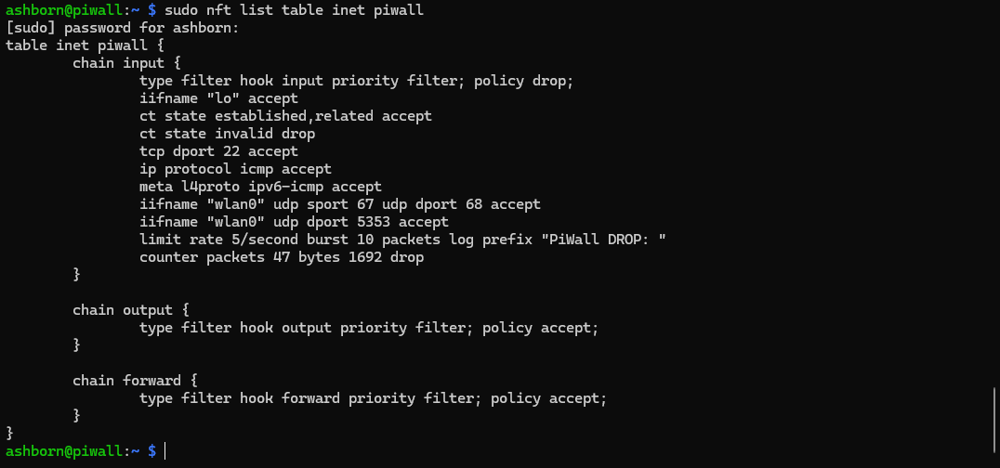

# PiWall

**A Raspberry Pi-based firewall for exploring Linux networking, network security and traffic management.**

## Overview

I started PiWall to understand how firewalls work beyond the security features available on a standard router.

Using a Raspberry Pi and nftables, I built a custom stateful firewall capable of filtering incoming traffic, tracking connections, monitoring discarded packets and logging network activity.

The goal is to gradually develop PiWall into a dedicated network security gateway while gaining practical experience in Linux networking and system security.

## Hardware & Software

| Component | Specification |
|---|---|
| Hardware | Raspberry Pi 3 Model B |
| Operating System | Raspberry Pi OS (32-bit) |
| Firewall | nftables |
| Service Management | systemd |
| Remote Access | SSH |
| Network Interfaces | Wi-Fi / Ethernet |

## Features

- IPv4 and IPv6 packet filtering
- Stateful connection tracking
- Default-deny incoming traffic policy
- TCP and UDP traffic filtering
- Packet and byte counters
- Rate-limited traffic logging
- Persistent firewall configuration
- Automatic startup and configuration reloading

## Firewall Architecture

| Chain | Policy | Function |
|---|---|---|
| INPUT | DROP | Filters incoming traffic |
| OUTPUT | ACCEPT | Allows outgoing traffic |
| FORWARD | ACCEPT | Reserved for gateway development |

## Documentation

| Section | Description |
|---|---|
| [Network Fundamentals](docs/01-network-fundamentals.md) | Network interfaces, IP addressing, routing and connectivity |
| [Firewall Implementation](docs/02-firewall-implementation.md) | Packet filtering, connection tracking, logging and persistence |
| [Testing & Validation](docs/03-testing-and-validation.md) | Firewall behaviour and reliability testing |
| [Firewall Configuration](config/piwall.nft) | Complete nftables configuration |

## Project Status

PiWall currently operates as a functional host-based firewall. The next stage focuses on network routing, segmentation and filtering traffic between connected devices.
