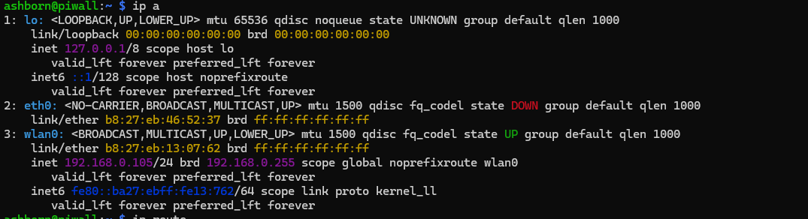
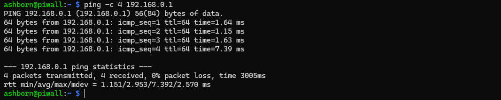
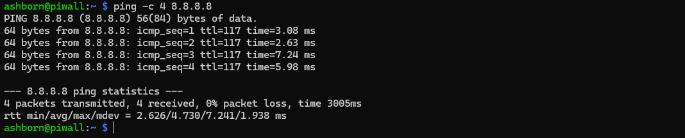
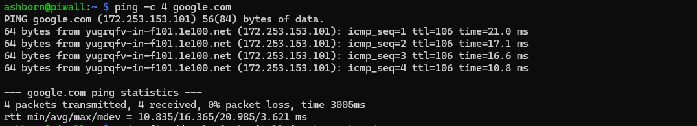

# Network Fundamentals

Before implementing the firewall, I wanted to understand how the Raspberry Pi communicates within a local network and accesses the internet. This involved examining network interfaces, IP addressing, routing and connectivity.

## 1. Network Interfaces

The available network interfaces were identified using:

`ip a`

| Interface | Purpose | Status |
|---|---|---|
| `lo` | Internal loopback communication | Active |
| `eth0` | Wired Ethernet connection | Disconnected |
| `wlan0` | Wireless network connection | Active |

The Raspberry Pi is connected to the local network through Wi-Fi.

## 2. IP Addressing and Routing

The routing table was examined to understand how packets travel within and outside the local network.

`ip route`

| Parameter | Configuration |
|---|---|
| Device IP | `192.168.0.105` |
| Subnet | `192.168.0.0/24` |
| Subnet Mask | `255.255.255.0` |
| Default Gateway | `192.168.0.1` |
| Active Interface | `wlan0` |
| IP Assignment | DHCP |

External traffic is directed through the default gateway, while local traffic can be delivered directly through the wireless interface.

## 3. Local Network Connectivity

Communication with the home router was tested using ICMP echo requests.

`ping -c 4 192.168.0.1`

This verifies that the Raspberry Pi can communicate with its default gateway.

## 4. External Network Connectivity

An external IP address was tested to verify internet connectivity independently of DNS resolution.

`ping -c 4 8.8.8.8`

This helps distinguish network connectivity problems from DNS-related issues.

## 5. DNS Resolution

The final connectivity test used a domain name instead of an IP address.

`ping -c 4 google.com`

| Parameter | Result |
|---|---|
| Packets Transmitted | 4 |
| Packets Received | 4 |
| Packet Loss | 0% |
| Average Latency | 16.365 ms |
| DNS Resolution | Successful |

## Testing & Validation

| Validation | Status |
|---|---|
| Network interface identification | Passed |
| IP address verification | Passed |
| Routing table verification | Passed |
| Default gateway connectivity | Passed |
| External network connectivity | Passed |
| DNS resolution | Passed |

## Conclusion

This initial setup helped me understand how Linux handles network interfaces, IP addressing and packet routing. Establishing a reliable network configuration provided the foundation for implementing and testing the firewall.
