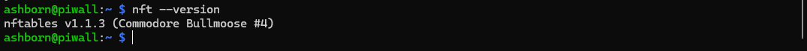
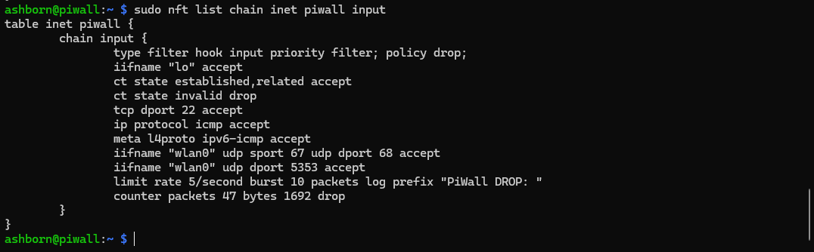
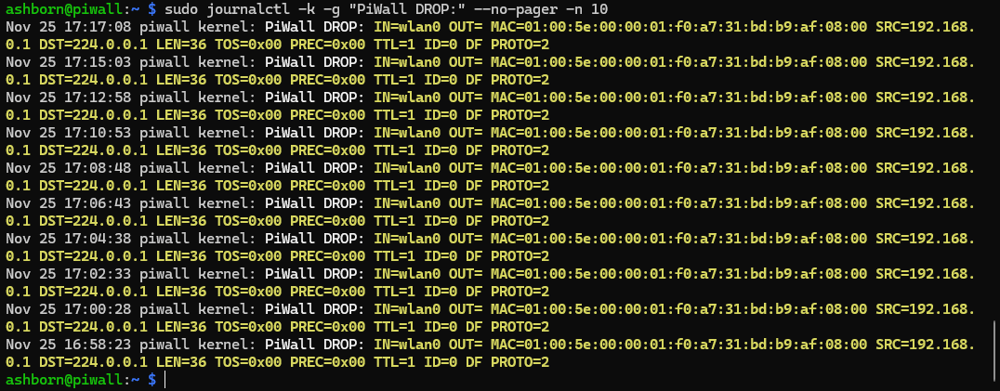

# Firewall Implementation

With the network configuration established, I moved on to building a custom firewall using nftables. My goal was to understand how Linux handles incoming traffic, tracks connections and decides which packets should be allowed or blocked.

## 1. Firewall Setup

The firewall was implemented directly on the Raspberry Pi without relying on third-party firewall management software.

| Component | Specification |
|---|---|
| Hardware | Raspberry Pi 3 Model B |
| Operating System | Raspberry Pi OS Lite |
| Firewall | nftables |
| Version | 1.1.3 |
| Service Management | systemd |
| Protocol Support | IPv4 and IPv6 |

The installed version was verified using:

`nft --version`

## 2. Firewall Architecture

I created a dedicated firewall table called `piwall` with three chains to manage different directions of network traffic.

| Chain | Policy | Function |
|---|---|---|
| INPUT | DROP | Filters incoming traffic |
| OUTPUT | ACCEPT | Allows outgoing traffic |
| FORWARD | ACCEPT | Reserved for network gateway development |

The INPUT chain follows a default-deny approach. Incoming packets are blocked unless they match an explicitly permitted rule.

## 3. Stateful Packet Filtering

Rather than blocking all incoming connections, I configured rules that allow essential network services while restricting unnecessary traffic.

| Rule | Function |
|---|---|
| Loopback | Allows internal system communication |
| Established and related | Allows traffic associated with existing connections |
| Invalid | Discards invalid packets |
| TCP 22 | Allows remote SSH access |
| ICMP / ICMPv6 | Allows essential network communication |
| UDP 67/68 | Allows DHCP responses |
| UDP 5353 | Allows multicast DNS |

The complete firewall configuration can be inspected using:

`sudo nft list table inet piwall`

[View complete firewall configuration](../config/piwall.nft)

## 4. Packet and Byte Counters

To observe the traffic being blocked, I added a counter to the final drop rule.

`counter drop`

This records the number of packets and their combined size reaching the final rule, providing a simple way to monitor firewall activity.

`sudo nft list chain inet piwall input`

## 5. Traffic Logging

Counting packets provides an overview of blocked traffic, but it does not explain where the traffic originates. To improve visibility, I implemented rate-limited logging.

`limit rate 5/second burst 10 packets log prefix "PiWall DROP: "`

| Parameter | Configuration |
|---|---|
| Average Logging Rate | 5 packets per second |
| Burst Allowance | 10 packets |
| Log Prefix | PiWall DROP: |
| Log Source | Linux kernel journal |

The logs provide information about source and destination addresses, protocols, packet sizes and ports where applicable.

Live firewall activity can be monitored using:

`sudo journalctl -k -f -g "PiWall DROP:"`

## 6. Firewall Persistence

One issue I encountered during development was that manually configured firewall rules did not survive a reboot.

To resolve this, I stored the configuration in `/etc/nftables.conf` and enabled the nftables service to automatically load the rules during system startup.

`sudo systemctl enable nftables`

The service status was verified using:

`sudo systemctl status nftables --no-pager`

## 7. Configuration Management

To avoid duplicate rules when reloading the firewall, the configuration replaces the existing PiWall table before recreating it.

`destroy table inet piwall`

Before applying changes, the configuration syntax is checked using:

`sudo nft -c -f /etc/nftables.conf`

The firewall can then be reloaded using:

`sudo systemctl reload nftables`

## Current Limitations

- Firewall protection is currently limited to the Raspberry Pi itself.
- Outgoing and forwarded traffic remain unrestricted.
- Packet counters reset when the firewall table is recreated.
- Invalid packets discarded by earlier rules are not included in the final counter or logging rule.

## Conclusion

Building this firewall gave me practical experience with Linux networking, stateful packet filtering, connection tracking and system service management. It also helped me understand the importance of testing, configuration persistence and monitoring when developing a network security system.

The implementation provides a working foundation for developing PiWall into a dedicated network security gateway.

## Related Documentation

- [Network Fundamentals](01-network-fundamentals.md)
- [Testing and Validation](03-testing-and-validation.md)
- [Firewall Configuration](../config/piwall.nft)
