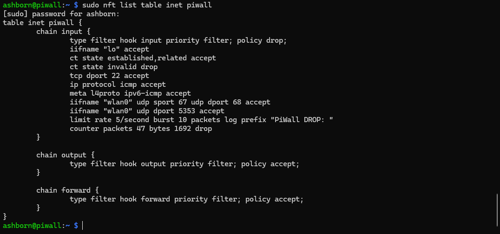
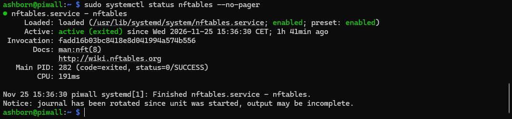
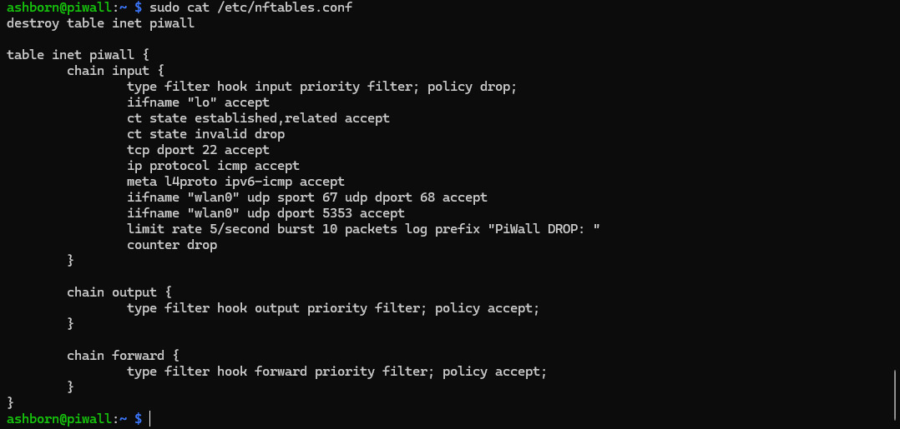

# Firewall Implementation

After setting up the network, I started building a custom firewall using nftables. The goal was to understand how Linux handles network traffic and how firewall rules can be used to control incoming connections.

## 1. Firewall Setup

| Component | Specification |
|---|---|
| Hardware | Raspberry Pi 3 Model B |
| Operating System | Raspberry Pi OS Lite |
| Firewall | nftables v1.1.3 |
| Service Management | systemd |
| Protocol Support | IPv4 and IPv6 |

`nft --version`

## 2. Firewall Architecture

A dedicated firewall table named `piwall` was created with three chains.

| Chain | Policy | Purpose |
|---|---|---|
| INPUT | DROP | Filters incoming traffic |
| OUTPUT | ACCEPT | Allows outgoing traffic |
| FORWARD | ACCEPT | Reserved for gateway development |

Incoming traffic is blocked by default unless permitted by a firewall rule.

`sudo nft list table inet piwall`

The firewall allows SSH, ICMP, DHCP, mDNS and traffic associated with established or related connections.

[View firewall configuration](../config/piwall.nft)

## 3. Packet Monitoring

I added packet and byte counters to observe how much traffic reaches the final drop rule.

`sudo nft list chain inet piwall input`

| Parameter | Recorded Value |
|---|---|
| Dropped Packets | 47 |
| Dropped Bytes | 1,692 |

## 4. Traffic Logging

To better understand the blocked traffic, I implemented rate-limited logging.

| Parameter | Configuration |
|---|---|
| Logging Rate | 5 packets/second |
| Burst Allowance | 10 packets |
| Log Prefix | PiWall DROP: |

`sudo journalctl -k -g "PiWall DROP:" --no-pager -n 10`

The captured logs show discarded IGMP multicast traffic from the local router, demonstrating that the logging system is operational.

## 5. Firewall Persistence

During development, I noticed that manually configured rules were lost after rebooting. To resolve this, I enabled the nftables service and stored the configuration permanently.

`sudo systemctl status nftables --no-pager`

The configuration is stored in `/etc/nftables.conf` and automatically loaded during startup.

`sudo cat /etc/nftables.conf`

The configuration also supports reloading without creating duplicate rules.

## Conclusion

PiWall now operates as a functional host-based firewall with stateful packet filtering, traffic monitoring, logging and automatic startup.

Building it helped me gain practical experience with Linux networking and firewall configuration. The next step is to extend this functionality into a network gateway.

## Related Documentation

- [Network Fundamentals](01-network-fundamentals.md)
- [Testing and Validation](03-testing-and-validation.md)
- [Firewall Configuration](../config/piwall.nft)
